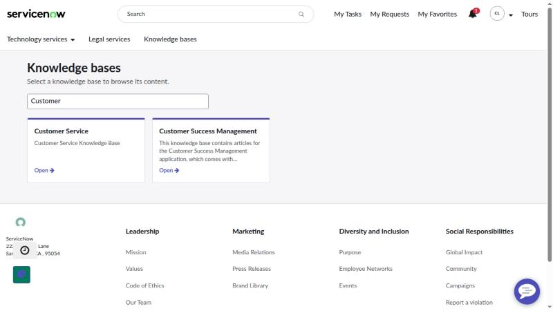
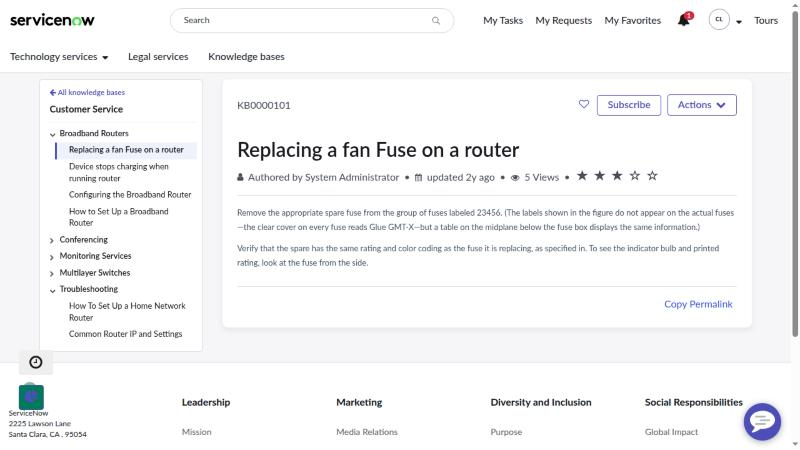

# ServiceNow KB Tree Navigation

Documentation-style navigation for ServiceNow Knowledge Management in Service Portal and Employee Center.

Out of the box, a knowledge base in the portal is a search page plus a flat list of categories. This project adds two widgets and two portal pages that give readers the experience they know from product documentation sites:

- a **knowledge base list** where users pick the base they want to browse;
- an **article page with a tree on the left** (categories, sub-categories and articles), the current article highlighted and its branch expanded, and the article itself on the right.

Only the bases and articles the user is allowed to read are shown.





## Contents

| Path | What it is |
|---|---|
| `widgets/kb-tree-navigation/` | Widget **KB Tree Navigation** (`kb-tree-navigation`): server script, client controller, HTML template, SCSS, option schema, and the recursive Angular ng-template `kbtree-node.html` |
| `widgets/kb-selector/` | Widget **KB Selector** (`kb-selector`): card list of the readable knowledge bases, with a filter box |
| `scripts/install.js` | Installer to run in *Scripts - Background*: creates or updates the widgets, the two pages and an optional header menu entry |
| `tools/build_install.py` | Rebuilds `scripts/install.js` from the files in `widgets/` |

## Requirements

- Service Portal with the **Knowledge Management - Service Portal** plugin (the article page reuses the out-of-the-box widget `kb-article-content`).
- Tested on the **Brazil** release, in Employee Center (`/esc`). It should work the same way in the classic Service Portal (`/sp`), but this has not been tested.
- Server scripts are ES5 and run in the global scope.

## Installation

### Option A - installer script (recommended)

1. Select or create an update set, for example *KB Tree Navigation*.
2. Open **System Definition > Scripts - Background**, keep the scope on **global**.
3. Paste the content of [`scripts/install.js`](scripts/install.js). Adjust `CONFIG` at the top if needed:
   - `homePage` / `articlePage`: page ids (default `kb_tree_home` and `kb_tree_article`);
   - `menuTitle`: header menu that receives the entry (`Employee Center Menu` for Employee Center, `SP Header Menu` for `/sp`, empty string to skip);
   - `menuLabel`, `menuOrder`.
4. Click **Run script**. The output lists what was created or updated:

   ```
   [kb-tree-navigation] updated sp_widget ...
   [kb-tree-navigation] created page kb_tree_home (...)
   [kb-tree-navigation] created page kb_tree_article (...)
   [kb-tree-navigation] created menu item "Knowledge bases" in Employee Center Menu
   [kb-tree-navigation] done
   ```

5. Open `/esc?id=kb_tree_home` (or click **Knowledge bases** in the header).

The script can be run again: widgets are updated in place, pages and the menu item are only created if they do not exist.

### Option B - manual

1. **Service Portal > Widgets > New**: create each widget from the files in `widgets/` (server script, client controller, HTML template, CSS - SCSS, option schema).
2. On *KB Tree Navigation*, add the Angular ng-template `kbtree-node.html` (related list **Angular ng-templates**).
3. **Service Portal > Pages**: create
   - `kb_tree_home`: one 12-column row with *KB Selector*;
   - `kb_tree_article`: one row with *KB Tree Navigation* (3 columns) and *Knowledge Article Content* (9 columns).
4. Add a menu item of type URL, `?id=kb_tree_home`, to the portal header menu.

## How it works

### URLs

| Page | Parameters |
|---|---|
| `?id=kb_tree_home` | none |
| `?id=kb_tree_article` | `kb_id` (knowledge base sys_id) and either `sys_kb_id` (article sys_id) or `sysparm_article` (article number, e.g. `KB0000101`) |

`sysparm_article` is resolved inside the given `kb_id`, so duplicate article numbers across bases are not an issue. Links inside articles can therefore point to `?id=kb_tree_article&kb_id=<base>&sysparm_article=KBxxxxxxx` to keep readers in the tree view.

### Widget options

| Widget | Option | Default | Purpose |
|---|---|---|---|
| KB Tree Navigation | `kb_id` | - | Base used when the URL has no `kb_id` |
| KB Tree Navigation | `article_page` | `kb_tree_article` | Page opened by the tree links |
| KB Tree Navigation | `home_page` | `kb_tree_home` | Target of the "All knowledge bases" link |
| KB Selector | `article_page` | `kb_tree_article` | Page opened by the cards |

### Tree building

1. Categories are read level by level from `kb_category` (`parent_id`), one query per level, up to 8 levels.
2. Published, latest, active articles of the base are read in a single query, sorted by number.
3. Each article is attached to its category; articles without a category are listed at the top.
4. Empty categories are removed; the branch that contains the current article is expanded. When no article is selected, the first level is expanded.

Categories are sorted by label, articles by number. Change the `orderBy` calls in the server script to sort differently.

## Security

- Articles are read with `GlideRecordSecure`, so the read ACLs and the knowledge **user criteria** (*Can Read* / *Cannot Read*) decide what is listed.
- Categories are read with `GlideRecord`, but a category that contains no readable article is removed before the data reaches the browser.
- The KB Selector lists a base only if the user can read at least one of its published articles.
- The article content itself is rendered by the out-of-the-box `kb-article-content` widget, with its own access checks.

To check, impersonate a user who is excluded by a *Cannot Read* user criterion: the base must disappear from the list and its articles from the tree.

## Limits and performance

- KB Selector runs one `setLimit(1)` query per active base (up to 100 bases). Fine for a few dozen bases; add caching beyond that.
- KB Tree Navigation loads up to 1,000 articles per base.
- The first article opened from the list is the one with the lowest number. To open a chosen landing article instead, store it on the base (custom field or system property) and adapt the selector.
- The widgets are global-scope portal records. For a scoped application, create them in the application scope and keep the same code.

## Uninstall

Delete, in this order: the menu item (**Service Portal > Menus**, your header menu), the pages `kb_tree_home` and `kb_tree_article`, then the ng-template `kbtree-node.html` and the widgets `kb-tree-navigation` and `kb-selector`. Or back out the update set used for the installation.

## Development

Edit the files in `widgets/`, then rebuild the installer:

```sh
python3 tools/build_install.py
```

## License

[MIT](LICENSE)
